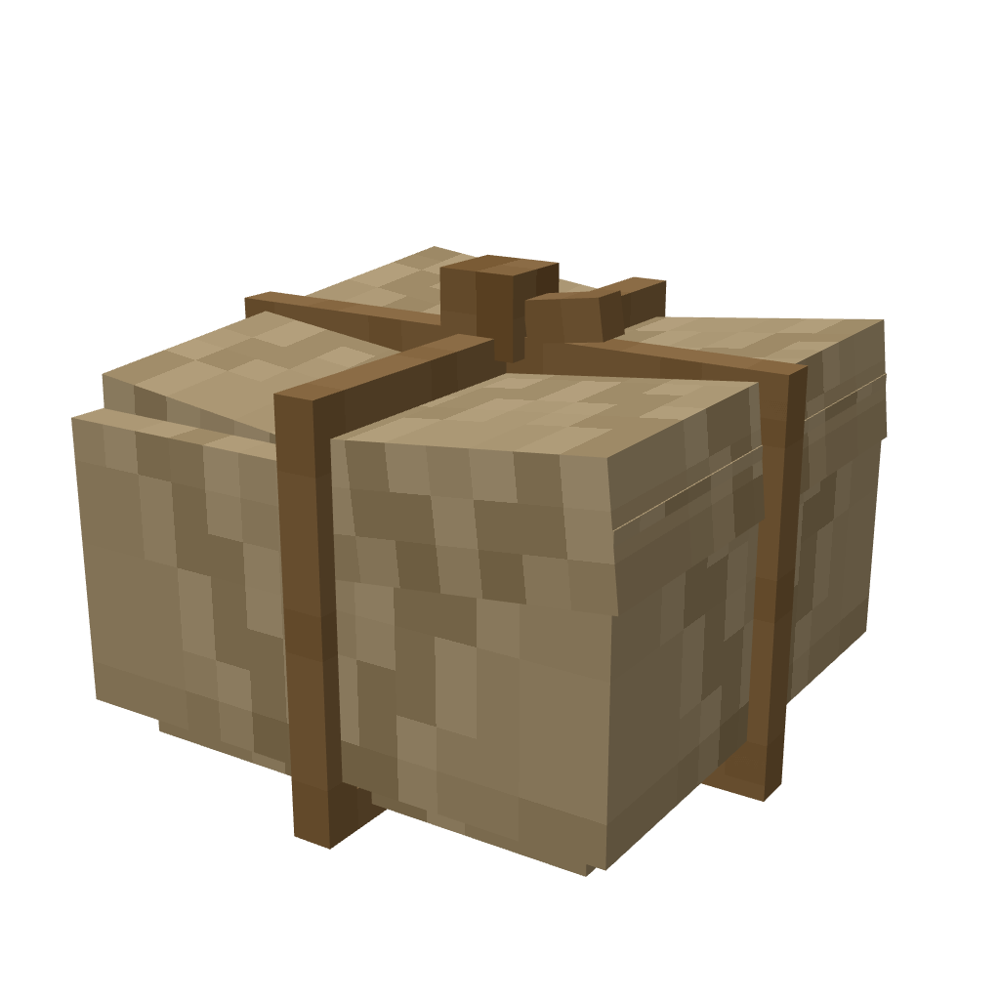
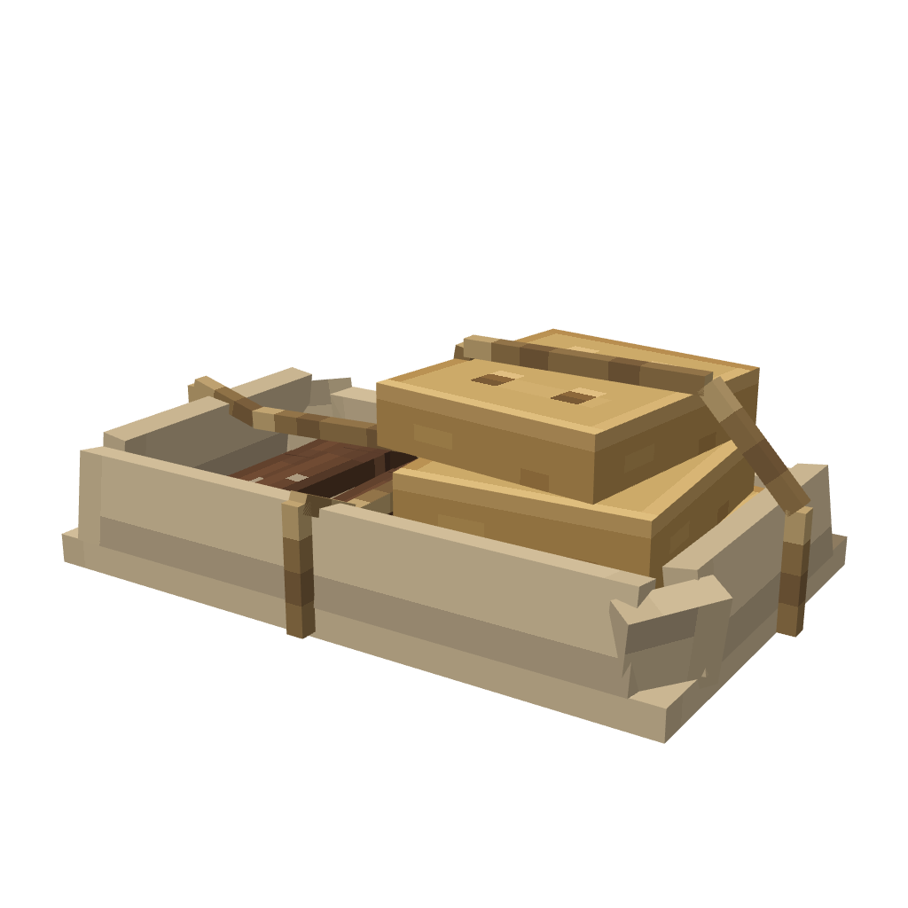
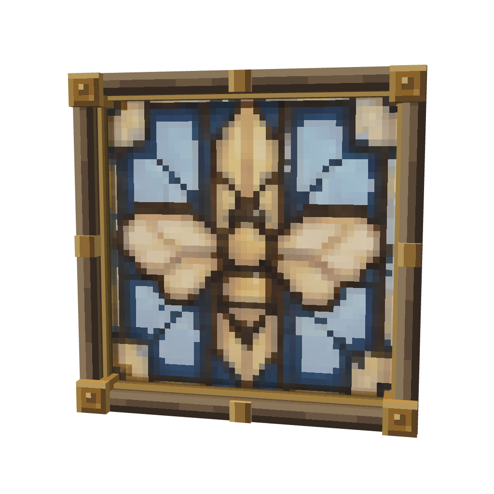
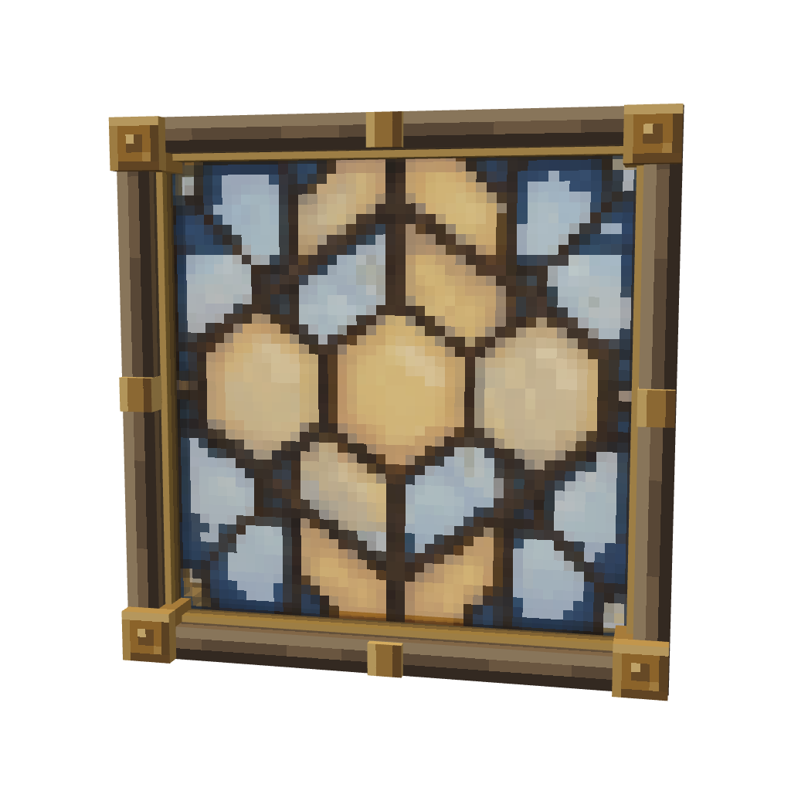
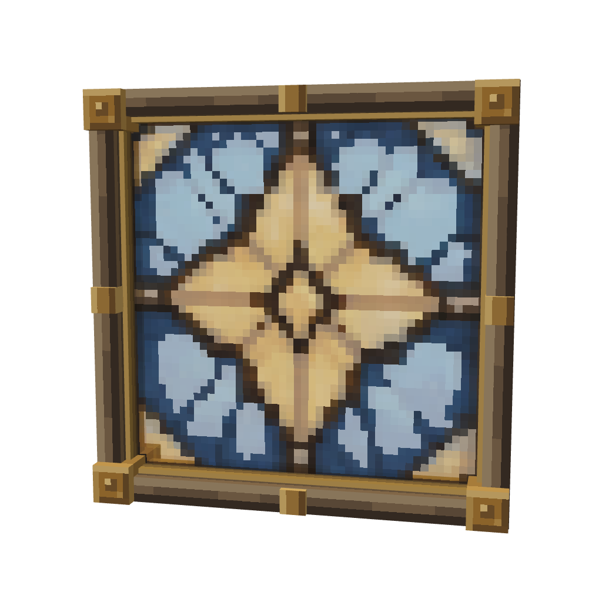
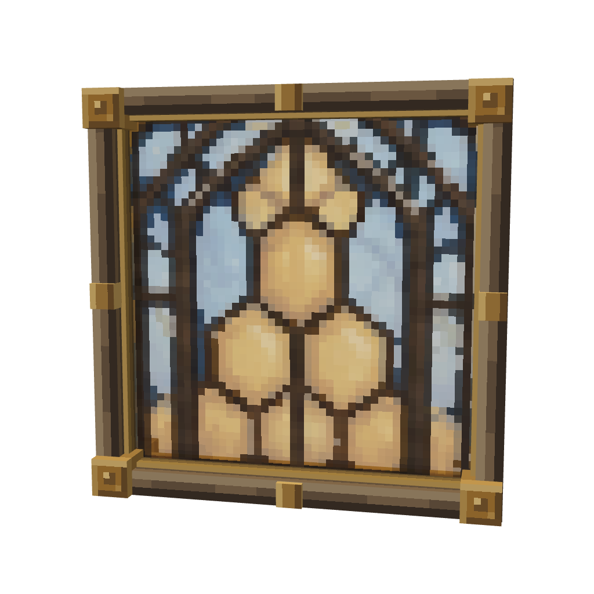
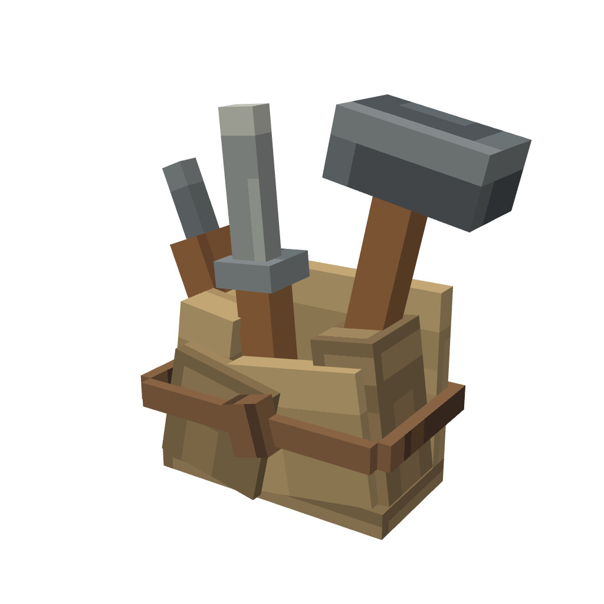

# Adersyn Hytale Models

Editable Blockbench models, Hytale exports, textures, and previews.

Each model folder contains `.bbmodel`, `.blockymodel`, a PNG texture, and a 1024×1024 transparent PNG preview rendered in Blockbench.

## Models

### adersyn_copper_lock

[Model files](adersyn_copper_lock/)

### adersyn_generic_bundle

[Model files](adersyn_generic_bundle/)

### adersyn_rations

[Model files](adersyn_rations/)

### adersyn_stained_glass_window

[Model files](adersyn_stained_glass_windows/adersyn_stained_glass_window/)

### adersyn_stained_glass_window_honigwabe

[Model files](adersyn_stained_glass_windows/adersyn_stained_glass_window_honigwabe/)

### adersyn_stained_glass_window_luminor_stern

[Model files](adersyn_stained_glass_windows/adersyn_stained_glass_window_luminor_stern/)

### adersyn_stained_glass_window_wabenranke

[Model files](adersyn_stained_glass_windows/adersyn_stained_glass_window_wabenranke/)

### adersyn_tools

[Model files](adersyn_tools/)

### adersyn_trophy

[Model files](adersyn_trophy/)

## License

See [LICENSE.md](LICENSE.md).
